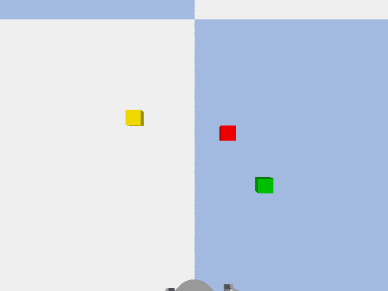

# SightLoop

A vision-grounded LLM agent for tabletop robot manipulation, built as a
**failure-aware evaluation harness**. The deliverable is not the demo, it is the
measurement: *where* an LLM-driven manipulation agent fails (perception, planning,
or control), and *whether* fault-aware recovery actually helps.

<p align="center">
  
  
</p>

<p align="center"><em>Left: a clean pick-and-place. Right: an injected mis-grasp with no recovery.</em></p>

## Research question

In LLM-driven robot manipulation, where do failures come from? Perception,
planning, or control and does recovery meaningfully improve task completion over
a no-recovery baseline?

## How it works

A simulated Franka Panda arm (PyBullet) on a table with colored blocks:

1. **Perceive**: camera image → block colors and positions (classical color
   segmentation + un-projection from depth).
2. **Plan**: an LLM turns a natural-language instruction into structured tool calls.
3. **Act**: `pick` / `place_on` / `place_relative` drive the arm via inverse kinematics.
4. **Verify**: each action returns a *measured* result (finger width, achieved
   position), never an assumed one.
5. **Recover**: on a transient failure, re-perceive and retry.

Failures are measured separately at each stage against explicit baselines.

## Results

Seeded stack / relative-placement tasks, free Groq `openai/gpt-oss-20b` planner:

| Metric | Result |
|---|---|
| Plan validity | 100% |
| Task success (real perception) | 81% |
| Task success (perfect-perception oracle) | 100% |
| **Perception gap** | **19 points** |
| Recovery under injected mis-grasp | **0% → 88%** |
| Perception detection / position error | 100% / 2.8 mm |
| Ambiguity detection / over-clarification | 100% / 0% |

Identical results across three open planners (gpt-oss-20b, qwen3.8-27b,
gpt-oss-120b): **planning is not the bottleneck, perception and control are.**

## Honest failure analysis

- **Perception is accurate in isolation but fragile during manipulation.** It
  detects every block at 2.8 mm on a clear table, yet the 19-point gap comes from the
  **arm occluding its own top-down camera** mid-task.
- **Recovery fixes control faults, not perception faults.** Retry-with-re-perception
  rescues a transient mis-grasp (0% → 88%) but cannot fix persistent occlusion. The
  two residual failures are exactly the case where the arm can't clear the view
  without dropping the held block.
- **Symptom ≠ root cause.** Some `slipped` / `descend_failed` (control) failures are
  fixed by the oracle, showing their real cause is small perception errors.

## Setup

Requires Python 3.12 and a C++ compiler (PyBullet builds from source; on Windows.

```bash
git clone <repo-url> && cd sightloop
py -3.12 -m venv .venv
.venv\Scripts\Activate.ps1          # Windows (source .venv/bin/activate on Unix)
pip install -e ".[dev]"
```

Set a free Groq API key (console.groq.com):

```bash
$env:GROQ_API_KEY = "gsk_..."       # PowerShell
```

## Run

```bash
pytest -q                           # full test suite
python scripts/evaluate.py          # one-command evaluation + report
python scripts/make_gifs.py         # regenerate the GIFs
```

## Structure

- `src/sightloop/`: sim, perception, planner, control, executor, faults, tasks, metrics, batch
- `scripts/`: runnable entry points
- `tests/`: pytest suite
- `DECISIONS.md`: major design decisions with reasoning

## Limitations & future work

Top-down self-occlusion limits recovery while carrying; classical color perception
(a learned/VLM perception model is future work); lighting-variation tasks and
AWS-parallel evaluation are future work.